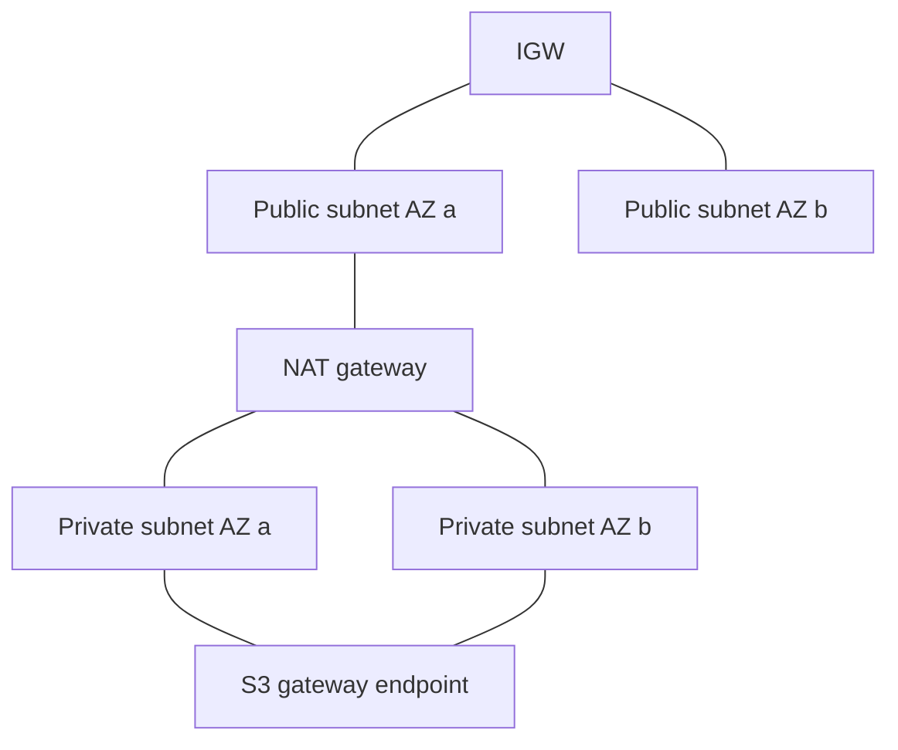
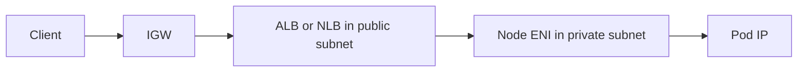
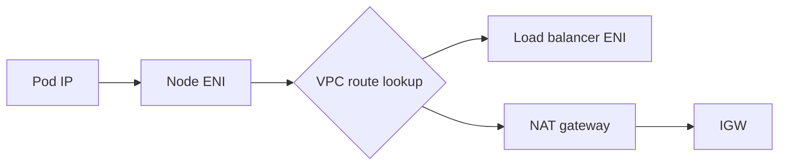
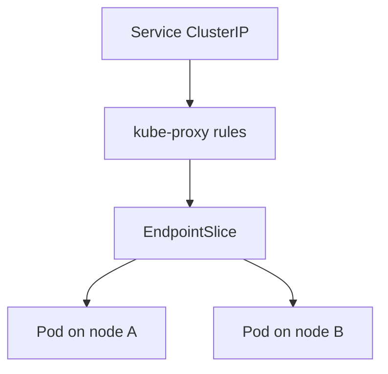
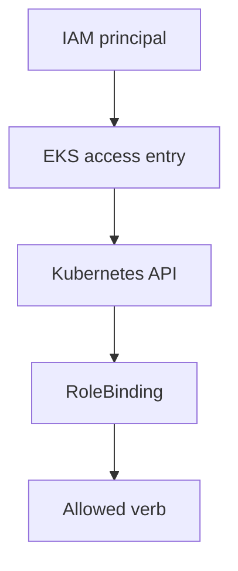

# Diagrams

The `.mmd` files in this directory are the editable source. The figures below are the same graphs. Notes sit under each figure. They are not drawn on top of the topology.

## VPC topology

Workers are only in the private subnets. The public subnets hold the NAT gateway and, later, load balancer ENIs. Both private route tables use the one NAT in the default layout, so AZ b's egress depends on AZ a. The S3 gateway endpoint is a route-table prefix list, not a network interface. Interface endpoints are not in this default picture.

## Forward path

The client packet arrives from the internet, the IGW, then the load balancer in a public subnet. The next hop is an ENI in a private subnet. For an ALB in IP mode that ENI is the pod's address on the worker. For an ALB in instance mode the ENI is the node, and kube-proxy is a second step that this drawing does not include.

## Return path and the route decision

The node looks up the destination in the private route table. A destination inside the VPC, such as the load balancer's private address, is delivered on the VPC fabric. A destination on the internet follows `0.0.0.0/0` to the NAT gateway, which translates the source and sends the packet to the IGW. NLB client-IP preservation makes the destination the client, so the reply takes the NAT path and misses the load balancer. Lab 10 turns preservation off for the instance-target case for that reason.

## kube-proxy is not a VPC route

A ClusterIP is not in the VPC route table. kube-proxy, or the IPVS or nftables mode it is using, DNATs the ClusterIP to an endpoint address from the EndpointSlice. The packet that then leaves the node toward a pod on the other node is a VPC packet with the pod IP as the destination. The VPC CNI has already assigned that pod IP from the subnet, so the VPC routes it to the other node's ENI.

## IAM then RBAC

The access entry is AWS IAM mapped into the API. The RoleBinding is Kubernetes. Both have to allow the call. A cluster-admin access policy does not make the node role into a workload role, and a RoleBinding does not grant `s3:GetObject`.
